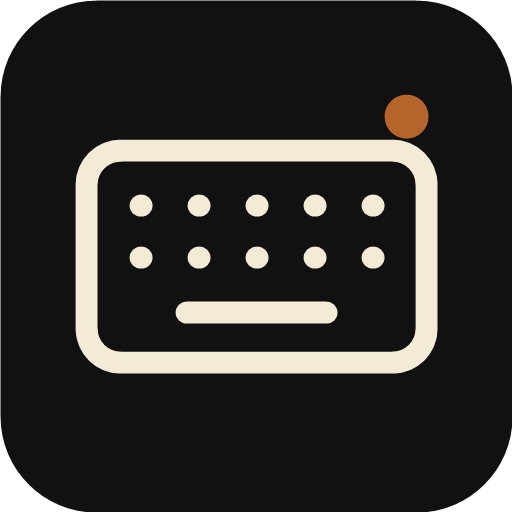
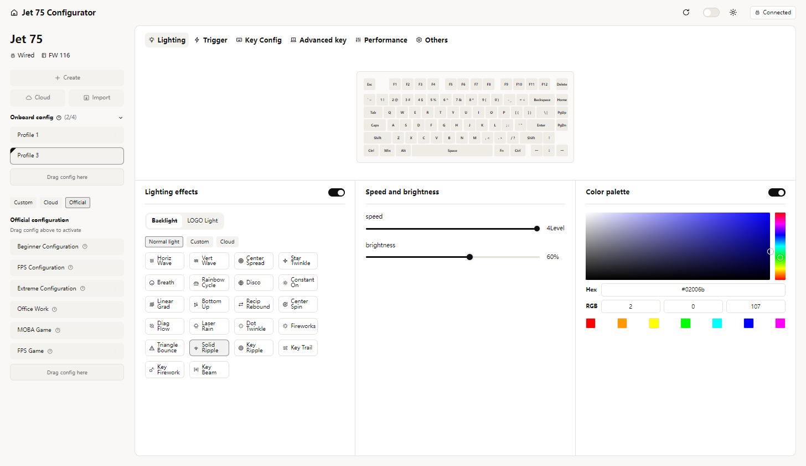
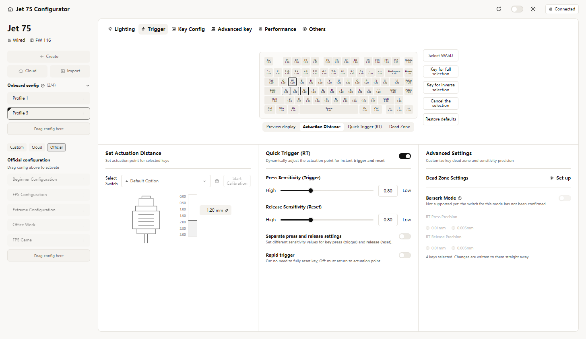
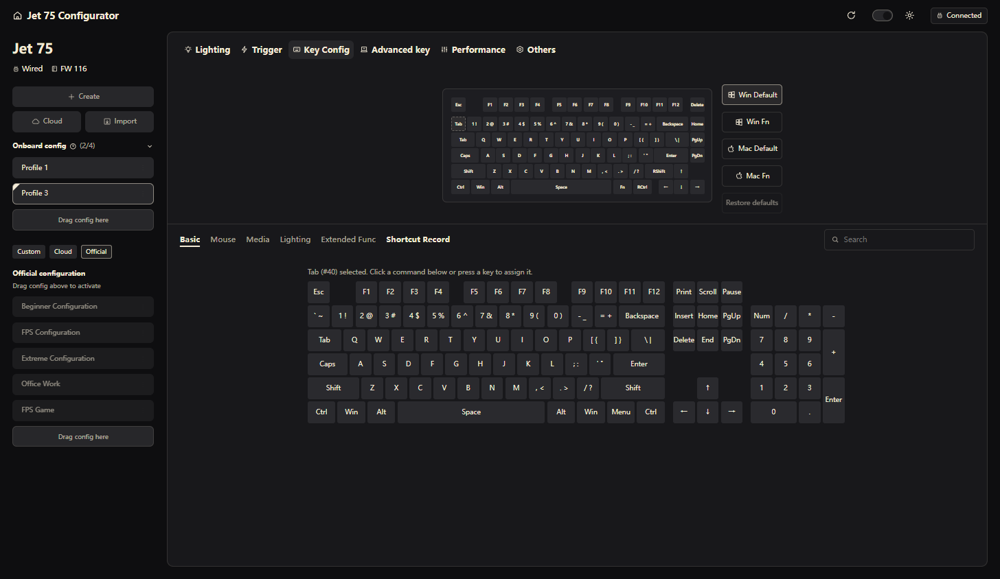
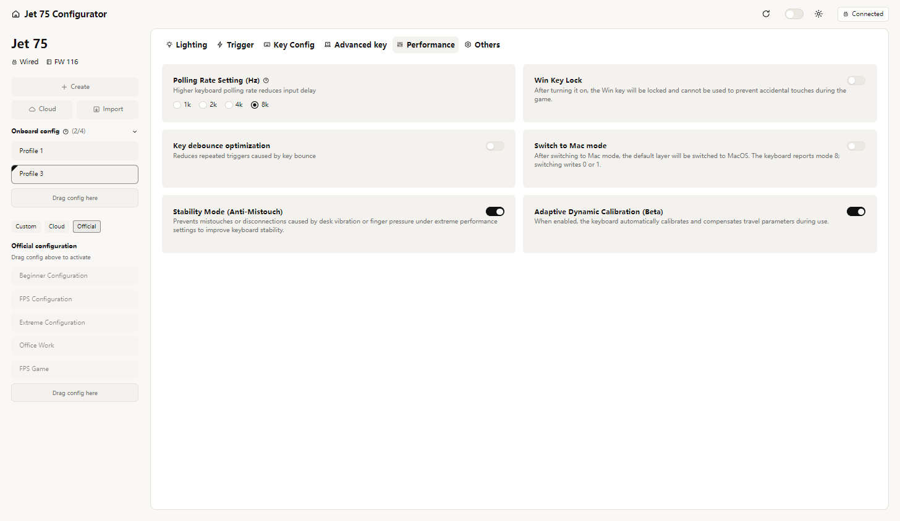
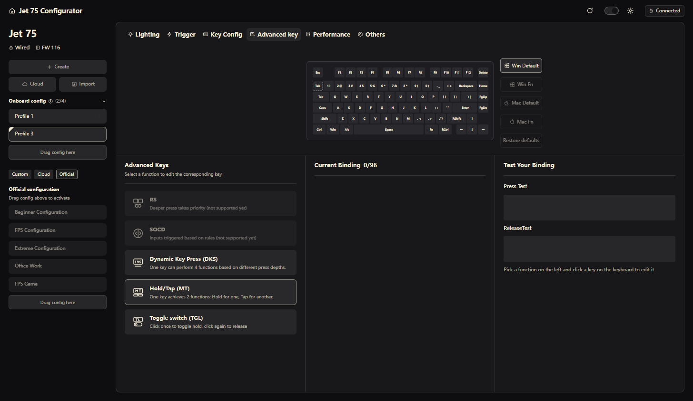

<p align="center">
  
</p>

<h1 align="center">Jet 75 Configurator</h1>

<p align="center">
  An open-source, fully offline configurator for the <b>MCHOSE Jet 75 II</b> magnetic keyboard.<br>
  No account. No cloud. No telemetry. No vendor app.
</p>

<p align="center">
  <a href="../../releases/latest">Download for Windows</a> ·
  <a href="docs/PROTOCOL.md">Protocol notes</a>
</p>



## Why

The official configurator is a web app that runs inside an Electron shell. It loads its code from remote servers each time it starts, sends analytics, and keeps pushing an account and cloud sync.

This app talks to the keyboard directly over USB HID, and that is all it does:

- **No network at all.** The app blocks every outgoing request at the Electron level. It never contacts mchose.com.cn, maicong.cn or any analytics endpoint, and it has no updater.
- **No telemetry, no tracking, no account.** Nothing about you or your keyboard leaves your PC.
- **Fully open source** (MIT). Every byte the app sends to the keyboard is documented in [docs/PROTOCOL.md](docs/PROTOCOL.md).
- **Safe by design.** Firmware update, bootloader, calibration and factory-reset commands are not implemented, so this app cannot brick your keyboard.

## Features

Everything the official driver offers for the Jet 75 II, with the same layout:

| Tab | What you can change |
|---|---|
| **Lighting** | 22 backlight effects with speed, brightness, direction and colour; LOGO light; per-key custom colours and saved static schemes; GIF effects; built-in animated effects; music rhythm lighting from your PC audio |
| **Trigger** | per-key actuation distance, switch type, quick trigger (RT) press/release sensitivity, rapid trigger, dead zones, Berserk mode (0.005 mm precision), live key-travel preview, switch calibration |
| **Key Config** | remap any key on Win/Mac default and Fn layers: keyboard, mouse, media, lighting and 50 extended functions, key combos, 16 recorded macros, search, restore defaults |
| **Advanced key** | RS, SOCD, Dynamic Keystroke (DKS), Hold/Tap (MT) with hold time, Toggle (TGL), live binding test |
| **Performance** | polling rate 1k / 2k / 4k / 8k Hz, Win key lock, Mac mode, debounce, stability mode, adaptive calibration |
| **Profiles** | 3 onboard configs: switch, rename, delete, export; custom configs saved on your PC; create and import configs; drag the 6 built-in configurations (Beginner, FPS, Extreme, Office Work, MOBA Game, FPS Game) onto the onboard list |
| **Others** | firmware version, reset the current config, restore factory settings |

Light and dark themes, with a toggle at the top right.

| | |
|---|---|
|  |  |
|  |  |

## Install

1. Download `Jet75-Configurator-Setup-x.y.z.exe` (installer) or `Jet75-Configurator-Portable-x.y.z.exe` (no install) from [Releases](../../releases/latest).
2. Connect the keyboard **with the USB-C cable** and start the app.

Windows SmartScreen may warn you because the exe is not code-signed. Choose *More info → Run anyway*, or build it yourself (below).

Close the official MCHOSE app or web page first. Only one program can talk to the keyboard at a time.

## Build from source

Requires Node.js 22+ on Windows.

```bash
npm install
npm start          # run the app
npm run dist       # build the installer and portable exe into release/
```

### Tests (need the keyboard plugged in)

```bash
npm run check       # read-only: prints firmware, profiles, lighting, key map
npm run test:write  # writes every setting type, reads it back, restores the original bytes
npm run test:ui     # drives the real window like a user, then restores everything
```

The write tests change your keyboard's settings for a few seconds and put every byte back afterwards.

## Supported hardware

| Keyboard | USB ID | Status |
|---|---|---|
| MCHOSE Jet 75 II (wired) | `41E4:211A` | fully tested on firmware 0x0116 |

Other MCHOSE magnetic keyboards probably use the same protocol, but they're untested. Issues and pull requests with test results are welcome.

## How it works

`src/main/protocol.ts` builds and parses the 64-byte HID packets, `src/main/device.ts` sends them with [node-hid](https://github.com/node-hid/node-hid), and `src/renderer/` is the UI.
The protocol was documented for interoperability, by observing what the keyboard stores when each setting changes. No vendor code, images or fonts are included in this repository.

## Disclaimer

This is an independent project and is not affiliated with, endorsed by or supported by MCHOSE. "MCHOSE" and "Jet 75" are trademarks of their owner and are used here only to name the hardware this app works with.
The software is provided as is, without warranty. You use it at your own risk.

## License

[MIT](LICENSE)
